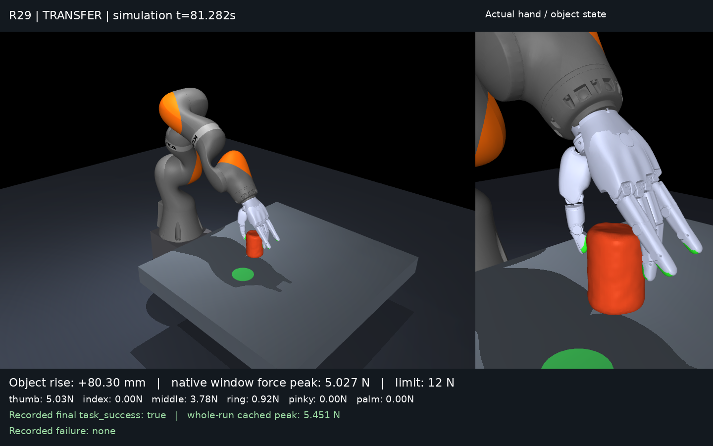

# EE5062 KUKA + Sharpa Simulation

MuJoCo 机械臂与灵巧手课程项目。当前主基线 R29 已在一个复用的 YCB 罐子场景完成抓取、抬升、搬运、放置和撤手。
本仓库用于四人协作；随机公共物体评测仍需完成，未声称任意物体成功率或真实机器人验证。
仓库公开，可直接查看、clone 或 fork；向原仓库直接推送仍需协作者权限。

**平台状态：**历史完整动态成功来自 Linux。2026-10-30 在 Mac 的独立目录新运行于 7.198 s
触发 `replay_mismatch`，是接触重放一致性失败，未完成任务。组员先验证 Windows/WSL2 的
完整基线兼容性；单元测试通过不代表跨平台动态复现通过。

- [老师要求与四人分工](docs/ASSIGNMENT_AND_TEAM_PLAN_ZH.md)
- [运行与下载说明](docs/GETTING_STARTED.md)
- [报告草稿](docs/EE5062_SUBMISSION_REPORT_20261030.md)
- [当前报告 PDF](docs/PROJECT_REPORT.pdf)
- [Release 下载与文件用途](docs/RELEASE_HANDOFF.md)
- [完整动态复现的平台限制](docs/R29_PORTABILITY_NOTE.md)
- [实验曲线](evidence/r29/trajectory_force.png)
- [Mac/Linux 严格审计](evidence/r29/independent_audit_macos_20261024.json)
- [动作顺序审计](evidence/r29/independent_sequence_audit_20261024.json)
- [当前 Mac 复现失败记录](evidence/mac_reproduction/result.json)

## 已有证据

| 实验 | 已记录结果 | 范围 |
| --- | --- | --- |
| R29 公共 YCB 罐子 | 抬升 82.924 mm；放置 XY 误差 4.160 mm；撤手后稳定 3.498 s；通道力峰值 5.451 N | 单个复用 seed 3414；包含 22 s 已验证命令前缀 |
| 连续工具整理 | marker / screwdriver / wrench，3/3 | 已知直立夹具、工程代理工具 |
| 三工具触觉对照 | 15/15 有触觉，10/15 无触觉保持 | 5 个配对种子，独立单工具试验 |
| 桌面支撑滚动 | 5/5 指关节调节，0/5 对照 | 依赖桌面支撑，不是悬空手内旋转 |
| 携物避障 | 一个螺丝刀任务通过，最小间隙 42.515 mm | 已知几何与指定走廊 |

这些分母不能合并。R29 真实目标位姿用于评价，控制使用机器人本体状态、模拟触觉、旧 RGB-D 锚点和声明的虚拟测力桌面。
当前没有训练 VLM/VLA。原生 MuJoCo 物理在 CPU 上积分，GPU 用于相机/视频渲染。

## 开始协作

1. Clone 本仓库，按 [GETTING_STARTED](docs/GETTING_STARTED.md) 安装并下载 `r29-runtime-inputs.zip`。
2. 运行输入校验和测试，再执行完整基线。仅 clone 源码不足以复现 R29，必须安装上述数据。
3. 从同一个 commit 建自己的分支，保存 commit、配置、种子列表和全部失败。
4. 提交代码与结果摘要的 PR；大视频和完整日志作为独立实验附件保存，避免提交进 Git 历史。

三台 Windows 电脑不需要接入实验室 Headscale，也不需要 DDP。每台机器独立运行不同实验，按统一协议汇总。
Windows 完整动态结果需各自实测；已保存的 Linux 结果与 Mac 审计不能自动证明 Windows 物理复现成功。

## 资料与授权

原始课程 PDF 保留在 Canvas，不在仓库再发布。[作业入口](https://canvas.nus.edu.sg/courses/97096/assignments/279618)。
KUKA、Sharpa、YCB 的来源、修改和许可证见 [THIRD_PARTY_NOTICES.md](THIRD_PARTY_NOTICES.md)。
项目使用 Codex 辅助实现与验证；组员贡献按实际完成的工作登记。Git 初始快照不代表此前工作的逐次提交历史。
公开可见不代表项目自有代码已授予额外开源许可证，第三方模型沿用各自许可证。

