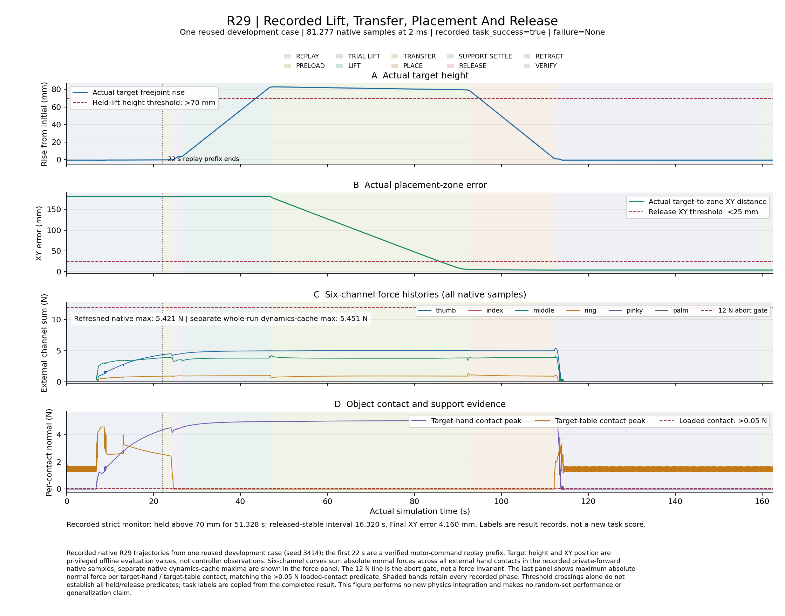

# Contact-Aware KUKA-Sharpa Grasping in MuJoCo

EE5062 Segment C, simulation-only review draft, 2026-10-30.

## 1. Objective and scope

The project builds a KUKA iiwa 14 arm with a Sharpa Wave dexterous hand in MuJoCo. The workcell contains a table, dividers, receiving slots, three actionable tools, distractors and public YCB meshes. The controller combines RGB-D pose estimates, native simulated tactile contacts, bounded joint control, contact-aware hand motion, collision checking and explicit failure records.

The current strongest public-object result is R29: one YCB tomato-soup-can development seed completes pick, lift, transfer, place, release and retract. This is a verified development case, not a randomized success-rate claim. The remaining randomized public-object and human-teleoperation requirements are reported explicitly as open.

## 2. Simulation and physics

MuJoCo 3.15.0 integrates the scene at 0.002 s on the CPU. EGL/OpenGL rendering was performed on the laboratory RTX4090. The R29 compiled model records gravity 9.81 m/s², target mass 0.349 kg, principal inertia 0.000359131/0.000357194/0.000204549 kg·m², target/table friction parameters 0.6/0.005/0.0001, contact solref 0.02/1.0 and 100 solver iterations. These values are simulation assumptions; no hardware force calibration is claimed.

## 3. Controller and sensing

The execution pipeline is staged: preload, event-based arrival, trial lift, full lift, XY transfer, place, table-support settle, release, retract and verify. A phase advances only after the actual wrist position and velocity satisfy the arrival gate continuously. Arm and finger commands are solved together under joint, rate, deflection and actuator-torque bounds. The actual actuator command is written once per step.

Simulated tactile signals come from native MuJoCo contact wrenches and touch channels. Six recorded channels retain thumb, index, middle, ring, pinky and palm loads. A historical RGB-D wrist estimate provides the object anchor for this development case and is propagated with the wrist pose during continuation; no new visual measurement is claimed during the R29 continuation. The table-support signal is a declared target-specific virtual instrument.

## 4. R29 complete task result

R29 integrated 81,277 consecutive native 2 ms steps over 162.554 s. Independent macOS and Linux audits accepted the source archive, compiled model, input hashes, native denominator, actual commands, motor-bound calculations, arrival transitions and strict physical gates.

| Metric | Measured result |
| --- | ---: |
| Maximum object rise | 82.924 mm |
| Qualified held period before transfer | 3.396 s |
| Held samples during transfer | 22,792 / 22,792 |
| Final XY placement error | 4.160 mm |
| Stable release after verify | 3.498 s |
| Final hand clearance | 148.467 mm |
| Whole-run cached channel peak | 5.451 N |
| Independently refreshed native peak | 5.421 N |
| External target qpos/qvel writes | 0 / 0 |

The video and plots are derived from recorded states. Rendering reconstructs kinematics and lighting only; it does not step or re-integrate the dynamics. The sequence audit verifies that the object was held before transfer, remained held throughout transfer, and was released after placement.



## 5. Other verified project components

The V7 workbench has six free bodies and a continuous seed-0 marker/screwdriver/wrench sorting run with 3/3 transfers. A paired tactile comparison reports shared control 15/15 versus 10/15 without tactile retention/control on seeds 40–44. Supported marker rolling reports 5/5 with an index override versus 0/5 control. A carried-screwdriver obstacle run completes with 42.515 mm minimum clearance and 14.448 mm docking error. These are separate protocols and are not pooled into one success rate.

## 6. Limitations and open requirements

The current R29 result reuses one known YCB can seed and a validated approach prefix. It does not establish randomized public-dataset grasp-pose generation, multiple independent YCB trials, or an 85% success rate. Tool objects are known engineering proxies in several V7 experiments. Dexterity evidence uses table support and does not prove general airborne in-hand manipulation. Tactile sensing is simulated. The teleoperation interface and replay path exist, but a person-produced recording has not yet been captured. VLM/VLA models are not used.

The official brief's mandatory baseline is workcell construction, random selection/placement of public-dataset objects, grasp-pose generation, execution, and repeated randomized evaluation. It does not impose an 85% threshold or require human teleoperation or VLM/VLA. Teleoperation is one of the team's chosen extensions following instructor feedback. A new Mac rollout on 30 October stops at 7.198 s with replay_mismatch; cross-platform full dynamic reproduction remains open, despite successful small-model tests and post-run audits.

## 7. Reproduction

Install `requirements-r29.txt` in a Python 3.13 virtual environment. Download the Release asset `r29-runtime-inputs.zip` and install its hash-bound inputs before running. From the project root:

```bash
.venv/bin/python scripts/prepare_r29_inputs.py --archive r29-runtime-inputs.zip
PYTHONPATH=src:scripts .venv/bin/python scripts/run_coordinated_pick_place_r29.py \
  --output results/my_new_full_pick_place
PYTHONPATH=src:scripts .venv/bin/python scripts/audit_coordinated_pick_place_r29.py \
  results/my_new_full_pick_place --output results/my_new_full_pick_place/audit.json
PYTHONPATH=src:scripts .venv/bin/python scripts/audit_r29_task_sequence.py \
  results/my_new_full_pick_place --output results/my_new_full_pick_place/sequence_audit.json
```

The output path must be new. The Git repository includes the KUKA, Sharpa and YCB assets, tests, runbooks and current R29 runner. Runtime inputs and full recorded R29 evidence are separate Release assets; source alone is insufficient. The older pre-submission ZIP is a historical review snapshot, not a standalone reproducible final submission.

## 8. AI acknowledgement and contribution statement

Codex was used for code drafting, test execution, experiment orchestration, audit implementation and report preparation. The student must review this wording, add the actual team member contributions, and follow the course policy before submission. No contribution or human operation is invented here.
